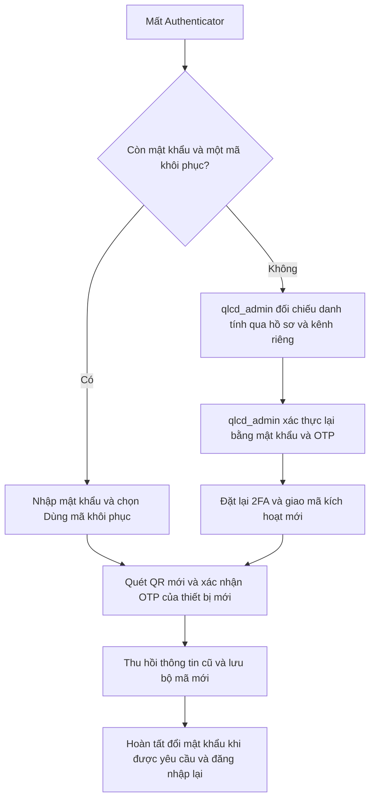

# Khôi phục tài khoản và Authenticator

## Mất hoặc đổi điện thoại

Mã khôi phục cho phép yêu cầu QR thay thế sau khi đã xác minh mật khẩu. Khi người dùng chứng minh đã đăng ký thiết bị mới, hệ thống tiêu thụ bộ mã cũ, thay khóa TOTP, tạo 10 mã mới và thu hồi phiên cũ. Người dùng hoàn tất đăng nhập lại bằng OTP của thiết bị mới. Nếu vẫn còn Authenticator, có thể tạo lại bộ mã trong **Bảo mật tài khoản** bằng mật khẩu và OTP mới.

## Quên mật khẩu hoặc mất cả bộ mã

Chỉ quản trị viên `qlcd_admin` được chỉ định theo ID cấu hình thấy hai thao tác trong **Tài khoản** cho tài khoản khác. Quyền đi theo ID và vai trò ADMIN khi tên đăng nhập đổi. Đối chiếu danh tính từ hồ sơ nội bộ và liên hệ qua đầu mối đã có của đơn vị.

Nếu danh sách chỉ có chính tài khoản đang đăng nhập, cột **Thao tác** sẽ chưa có hai nút reset. Trên cơ sở dữ liệu mới chỉ có ADMIN, tạo đơn vị theo quy trình để phát sinh tài khoản quản lý. Nếu đã có tài khoản khác mà hai nút vẫn vắng, kiểm tra `canResetCredentials` trong `GET /api/v1/accounts` và đối chiếu ID đã cấu hình với đúng cơ sở dữ liệu ứng dụng đang dùng. [Cấu hình quyền reset](SECURITY.md#nâng-schema-và-phát-hành)

- **Đặt lại mật khẩu** cấp lại `123456aA@` có hạn 24 giờ và yêu cầu đổi khi đăng nhập. Người dùng tiếp tục xác thực bằng Authenticator đã liên kết.
- **Đặt lại 2FA** thu hồi khóa Authenticator, bước OTP và mã khôi phục cũ, đồng thời giữ mật khẩu hiện tại. Xác nhận đã đối chiếu danh tính và giao riêng mã kích hoạt dùng một lần có hạn 24 giờ qua kênh tin cậy. Chủ tài khoản chọn **Thiết lập Authenticator bằng mã kích hoạt**, rồi nhập mã cùng tên đăng nhập và mật khẩu. Dùng lại thao tác này để cấp mã mới khi mã đã cấp hết hạn. [Các bước thiết lập](TWO_FACTOR_AUTHENTICATION.md)

Xác nhận từng thao tác và nhập mật khẩu cùng OTP mới của `qlcd_admin`. Mỗi lần thành công làm hết hiệu lực các phiên của tài khoản đích và ghi audit `AUTH_PASSWORD_RESET` hoặc `AUTH_MFA_RESET` với người thực hiện và tài khoản đích. Nếu mất cả mật khẩu và Authenticator, thực hiện từng thao tác với OTP khác nhau.

Khi chính `qlcd_admin` mất quyền truy cập, người vận hành được cấp quyền trên máy chủ xác minh danh tính và dùng `--provision-account` với `Bootstrap__Username` là tên đăng nhập hiện tại của tài khoản có ID đã cấu hình. Cấp mã mới 32 ký tự hex qua `Bootstrap__ActivationCode`. Lệnh khôi phục khẩn cấp đặt lại cả mật khẩu và Authenticator của tài khoản này. Giao mã riêng cho chủ tài khoản và dọn biến cấp tạm sau thao tác. [Triển khai và khôi phục](SECURITY.md)

## Thống nhất kết quả đặt lại

Reset mật khẩu không khác nhau theo vai trò CDCS, CDBP, TOCD hay ADMIN khác: tất cả trở về `123456aA@` trong 24 giờ và bắt buộc đổi trước khi vào nghiệp vụ. Cả hai thao tác reset giữ trạng thái khóa; nếu tài khoản đang khóa, admin phải mở khóa riêng khi được phép. Reset 2FA hoặc cấp mã cho tài khoản cũ giữ mật khẩu hiện tại vì đó là thao tác phục hồi thiết bị, không phải đặt lại mật khẩu. CLI khôi phục khẩn cấp quản trị viên đặt lại cả hai; xem bảng đối chiếu trong [kiến trúc xác thực](AUTHENTICATION.md#mật-khẩu-khởi-tạo-và-các-luồng-quản-trị).

Màn hình Tài khoản hiển thị mật khẩu khởi tạo từ chính sách backend, nêu giá trị và thời hạn trước khi xác nhận reset, rồi thông báo tài khoản nào đã được reset cùng kết quả chính xác. Người dùng ở bước đổi mật khẩu bắt buộc được nhắc rằng mật khẩu tạm chưa cho phép vào nghiệp vụ.

## Mở khóa có xác thực và khôi phục đơn vị

Trong Tài khoản, **Mở khóa** (hoặc **Mở khóa & khôi phục đơn vị** nếu cờ tài khoản đang mở nhưng đơn vị bị chặn) mở dialog nêu phạm vi ảnh hưởng. Admin xác nhận, nhập mật khẩu và OTP mới của chính mình. Hệ thống khôi phục chính đơn vị liên kết ngừng/ẩn trên cây theo ID cũ và mở tài khoản đã chọn trong một transaction; không tạo lại đơn vị, thay Khối hay ghép dữ liệu theo tên. Nếu đơn vị cha chưa hoạt động, thao tác bị từ chối, không đổi dữ liệu/tiêu thụ OTP. X/Hủy/Escape trước khi gửi không thực hiện thao tác.

Các tài khoản khác giữ cờ khóa/tombstone riêng; tài khoản khác đã mở có thể truy cập lại khi đơn vị hoạt động, còn tài khoản khóa vẫn khóa. Phiên liên quan bị thu hồi, phải đăng nhập lại. Mật khẩu và Authenticator được giữ nguyên; việc mở khóa không gia hạn mật khẩu/mã kích hoạt tạm. Tài khoản chưa thiết lập vẫn cần cấp mã, hoàn tất MFA và đổi mật khẩu nếu được yêu cầu.

Nếu màn hình đăng nhập báo thử sai quá số lần, khóa tạm thời tự hết sau 10 phút tính từ lúc khóa. Thao tác Mở khóa trong **Tài khoản** xử lý cờ quản trị và trạng thái đơn vị. Bộ đếm đăng nhập có vòng đời riêng. [Khóa đăng nhập](AUTHENTICATION.md)

Khôi phục đơn vị độc lập trong Cây tổ chức vẫn được giữ và không mở khóa tài khoản. Ngừng đơn vị vẫn bảo toàn mọi dữ liệu/quan hệ. Mở khóa đòi hỏi ADMIN đã hoàn tất MFA; quyền reset mật khẩu/2FA vẫn chỉ dành qlcd_admin khớp ID cấu hình. Không tự mở ADMIN/self qua API này; giữ quy trình quản trị khẩn cấp riêng.
