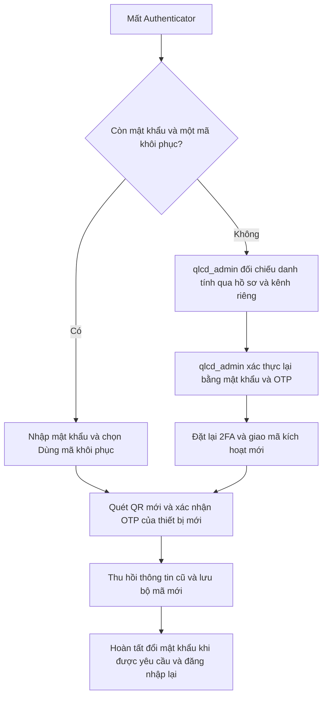

# Khôi phục tài khoản và Authenticator

## Mất hoặc đổi điện thoại

Mã khôi phục cho phép yêu cầu QR thay thế sau khi đã xác minh mật khẩu. Khi người dùng chứng minh đã đăng ký thiết bị mới, hệ thống tiêu thụ bộ mã cũ, thay khóa TOTP, tạo 10 mã mới và thu hồi phiên cũ. Người dùng hoàn tất đăng nhập lại bằng OTP của thiết bị mới. Nếu vẫn còn Authenticator, có thể tạo lại bộ mã trong **Bảo mật tài khoản** bằng mật khẩu và OTP mới.

## Quên mật khẩu hoặc mất cả bộ mã

Chỉ `qlcd_admin` có ID được cấu hình thấy hai thao tác trong **Tài khoản** cho tài khoản khác. Đối chiếu danh tính từ hồ sơ nội bộ và liên hệ qua đầu mối đã có của đơn vị.

- **Đặt lại mật khẩu** cấp lại `123456aA@` có hạn 24 giờ và yêu cầu đổi khi đăng nhập. Người dùng tiếp tục xác thực bằng Authenticator đã liên kết.
- **Đặt lại 2FA** thu hồi khóa Authenticator, bước OTP và mã khôi phục cũ, đồng thời giữ mật khẩu hiện tại. Xác nhận đã đối chiếu danh tính và giao riêng mã kích hoạt dùng một lần có hạn 24 giờ qua kênh tin cậy. Dùng lại thao tác này để cấp mã mới khi mã đã cấp hết hạn.

Xác nhận từng thao tác và nhập mật khẩu cùng OTP mới của `qlcd_admin`. Mỗi lần thành công làm hết hiệu lực các phiên của tài khoản đích và ghi audit `AUTH_PASSWORD_RESET` hoặc `AUTH_MFA_RESET` với người thực hiện và tài khoản đích. Nếu mất cả mật khẩu và Authenticator, thực hiện từng thao tác với OTP khác nhau.

Khi chính `qlcd_admin` mất quyền truy cập, người vận hành được cấp quyền trên máy chủ xác minh danh tính và dùng `--provision-account` với `Bootstrap__Username=qlcd_admin`, ID đã cấu hình và mã mới 32 ký tự hex qua `Bootstrap__ActivationCode`. Lệnh khôi phục khẩn cấp đặt lại cả mật khẩu và Authenticator của tài khoản này. Giao mã riêng cho chủ tài khoản và dọn biến cấp tạm sau thao tác. [Triển khai và khôi phục](SECURITY.md)
