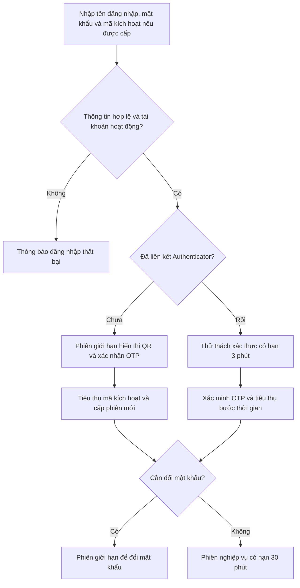
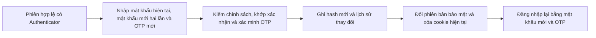

# Kiến trúc xác thực QLCD

Backend xác minh mật khẩu bằng PBKDF2-SHA256. Trình duyệt giữ cookie phiên HttpOnly cùng origin. SQL lưu bản băm token phiên, hạn dùng và phiên bản bảo mật. Mọi yêu cầu ghi dùng CSRF. Backend cấp vai trò nghiệp vụ khi tài khoản có Authenticator và đã hoàn tất đổi mật khẩu bắt buộc.

## Đăng nhập và tiếp tục thiết lập

Form mặc định chỉ gửi tên đăng nhập và mật khẩu. Tài khoản đã liên kết Authenticator chuyển sang bước nhập OTP. Khi chọn **Thiết lập Authenticator bằng mã kích hoạt**, form gửi thêm `activationCode` qua `POST /api/v1/auth/login`. Phiên giới hạn tối đa 10 phút, có thể kết thúc sớm theo hạn mật khẩu tạm hoặc mã kích hoạt. `/auth/authenticator/setup` dùng phiên đã xác minh để lấy cùng QR khi tải lại. Khóa thiết lập dở được mã hóa trong phiên. Backend tiêu thụ mã kích hoạt và bước OTP, cấp cookie và phiên mới trong cùng thao tác xác nhận. Giao diện chuyển thẳng vào phần mềm, hiển thị một lần bộ mã khôi phục và nhắc đổi mật khẩu mặc định. Nếu quản trị viên đã đặt lại mật khẩu trước bước thiết lập 2FA, bước đổi mật khẩu tạm vẫn bắt buộc. Phiên trước OTP bị chặn khỏi API nghiệp vụ.

Mật khẩu sai, mã kích hoạt sai và OTP sai trong luồng đăng nhập cùng tăng bộ đếm SQL. Sai lần thứ 5 nhận HTTP 429 với `Retry-After` và thời gian còn lại, khóa 10 phút tính theo UTC. Các yêu cầu trong thời gian khóa giữ nguyên mốc hết hạn. Xác thực OTP thành công hoặc hết hạn khóa đặt lại bộ đếm. Tên chưa tồn tại cũng có phản hồi tương đương. Giới hạn IP bổ sung độc lập với khóa theo tài khoản.

## Đổi mật khẩu

Mật khẩu mới có 8–128 ký tự, gồm ít nhất một chữ hoa, một chữ thường, một chữ số và một ký tự dấu câu hoặc ký hiệu. Khoảng trắng không đáp ứng điều kiện ký tự đặc biệt. Mật khẩu mới phải khác mật khẩu khởi tạo `123456aA@` và mật khẩu hiện tại. Đổi mật khẩu giữ khóa Authenticator và bộ mã khôi phục hiện tại. Sau Reset mật khẩu quản trị, việc đổi mật khẩu tạm trước khi vào nghiệp vụ vẫn bắt buộc. [Thiết lập Authenticator](TWO_FACTOR_AUTHENTICATION.md) · [Kiểm thử](TESTING.md)

## Mật khẩu khởi tạo và các luồng quản trị

Nguồn chuẩn của mật khẩu khởi tạo là `QLCD.Shared/Security/PasswordHasher.cs`, hằng `InitialPassword = "123456aA@"`; `AccountCredentials.InitialPassword` tham chiếu hằng này. Đây là chính sách trong source, không lấy từ appsettings, không sinh ngẫu nhiên theo tài khoản. Mỗi lần ghi dùng PBKDF2 với salt riêng nên hash giữa các tài khoản khác nhau dù mật khẩu khởi tạo giống nhau. Thời hạn mật khẩu tạm và mã kích hoạt được định nghĩa riêng trong `AccountCredentials` (hiện đều 24 giờ).

| Luồng | Mật khẩu sau thao tác | Trạng thái và yêu cầu tiếp theo |
| --- | --- | --- |
| Tạo đơn vị, tự sinh tài khoản CDCS/CDBP/TOCD | `123456aA@` | Khóa đến khi admin xác minh danh tính và cấp mã. Đăng nhập và hoàn tất 2FA trong 24 giờ để vào phần mềm. Hệ thống nhắc đổi mật khẩu mặc định. |
| Cấp mã kích hoạt cho tài khoản cũ chưa có MFA | Giữ nguyên | Không reset mật khẩu. Mã kích hoạt có hạn 24 giờ; không tự mở khóa tài khoản cũ. |
| Reset mật khẩu qua `/accounts/{id}/reset-password` | `123456aA@` cho mọi vai trò đích được hỗ trợ, kể cả ADMIN khác | Có hạn 24 giờ, bắt buộc đổi, thu hồi phiên qua SecurityVersion. Giữ Authenticator, mã khôi phục và trạng thái khóa. |
| Reset 2FA qua `/accounts/{id}/reset-2fa` | Giữ nguyên | Thay mã kích hoạt, xóa MFA/mã khôi phục cũ, thu hồi phiên; giữ cờ và hạn đổi mật khẩu cũng như trạng thái khóa. |
| CLI `--bootstrap-admin` | `123456aA@` | Khởi tạo quản trị viên với mã kích hoạt riêng. Hoàn tất 2FA trong 24 giờ rồi vào phần mềm và nhận nhắc đổi mật khẩu. |
| CLI khôi phục khẩn cấp `--provision-account` | `123456aA@` | Quản trị viên được chỉ định đăng ký lại MFA và phải đổi mật khẩu tạm trong 24 giờ. |
| CLI `--issue-mfa-enrollment` / khôi phục bằng mã cá nhân | Giữ nguyên | Chỉ thay hoặc thiết lập MFA theo quy trình; không reset mật khẩu. |

Không có form tạo tài khoản độc lập trong giao diện hiện tại: tài khoản quản lý được tạo cùng đơn vị; quản trị viên đầu tiên được bootstrap bằng CLI. Backend cho phép reset tài khoản khác khi ID trùng ID đã cấu hình cho `qlcd_admin` và vai trò hiện tại là ADMIN. Tên đăng nhập có thể thay đổi. Backend chặn tự reset qua API quản trị, chặn nghiệp vụ ở phiên giới hạn và từ chối mật khẩu khởi tạo khi chọn mật khẩu mới. `GET /api/v1/accounts` trả `canResetCredentials` từ cùng chính sách với API reset và `credentialPolicy` để hiển thị mật khẩu khởi tạo cùng thời hạn, không trả mật khẩu hay hash riêng của từng tài khoản.

## Trạng thái tổ chức và khóa tài khoản

Điều kiện truy cập gồm: tài khoản không bị soft-delete, cờ khóa đang mở, đơn vị liên kết và toàn bộ tổ tiên đang hoạt động. ADMIN không liên kết đơn vị tiếp tục dùng cơ chế quản trị hệ thống; nếu ADMIN có liên kết đơn vị thì cũng chịu điều kiện đơn vị. Điều kiện này được kiểm tra ở đăng nhập, mỗi yêu cầu xác thực phiên và dịch vụ phạm vi. Các truy vấn tiếp nhận đoàn viên cũng loại đơn vị có tổ tiên ngừng hoạt động.

Ngừng đơn vị không xóa hoặc khóa cờ riêng của tài khoản: UI hiển thị đồng thời “Đã mở khóa/Bị khóa” và “Bị chặn truy cập do đơn vị”. API accounts bổ sung `organizationActive`, `accountArchived`, `canSignIn`. Tài khoản gắn tổ chức bị soft-delete theo luồng cũ được đọc qua truy vấn quản trị có chủ đích để không biến mất; truy vấn đăng nhập/phiên vẫn giữ global filter. Kiểm tra cấu trúc trong validation có thể đếm cả con lưu trữ để không bỏ sót quan hệ; OperationalUnits luôn kiểm tra rõ IsDeleted và trạng thái của từng tổ tiên trước khi cấp quyền. Danh sách không tự phục hồi dữ liệu.

Ngừng đơn vị thu hồi phiên của mọi tài khoản gắn trực tiếp. Khôi phục còn thu hồi phiên thuộc nhánh con tối đa ba cấp để xử lý dữ liệu cũ có cha ngừng nhưng con vẫn hoạt động. Chỉ SecurityVersion thay đổi; cờ khóa, MFA và trạng thái con không đổi. Phiên cũ không sống lại khi khôi phục. Với tài khoản soft-delete cũ, quản trị viên phải mở khóa/khôi phục riêng (không áp dụng tự phục hồi ADMIN qua toggle). Các bản ghi thực sự đã bị hard-delete ở môi trường ngoài repo không thể tái tạo bằng luồng này.

## Mở khóa kèm khôi phục đơn vị

`POST /api/v1/accounts/{id}/unlock` yêu cầu phiên ADMIN đầy đủ, xác nhận, mật khẩu của quản trị viên và OTP mới. Backend kiểm tra lại vai trò, trạng thái và thông tin xác thực tại SQL. Chỉ áp dụng với tài khoản đích khác và có vai trò ngoài ADMIN. Thao tác mở khóa dành cho ADMIN hợp lệ. Hai thao tác reset tiếp tục yêu cầu `CredentialResetPermission` theo ID đã cấu hình của `qlcd_admin`.

Trong transaction Serializable: kiểm chứng actor, xác định đúng OrganizationId, khôi phục chính đơn vị nếu ngừng/IsDeleted (cha phải hoạt động), mở tài khoản đã chọn, clear tombstone cũ của tài khoản và thu hồi phiên/audit AUTH_ACCOUNT_UNLOCK cùng ORG_RESTORE khi có. OrganizationLifecycle tham gia transaction đang có, không commit riêng; lỗi cuối phải rollback cả phần restore đã save, trạng thái tài khoản, bước OTP và audit. Các tài khoản khác không được đổi cờ khóa/MFA/password; các phiên liên quan không được hồi sinh. Khối chỉ phân loại và không cản khôi phục khi liên kết khối cũ đã ngừng dùng.

Toggle v1 giữ tương thích cho thao tác khóa nhưng trả 409 khi bị dùng để mở; client cần chuyển sang endpoint unlock. Cấp mã kích hoạt bị từ chối khi đơn vị ngừng/ẩn để không vượt bước khôi phục có xác thực. Mở khóa không thay mật khẩu/Authenticator/hạn tạm và không thay thế các bước kích hoạt của tài khoản mới. API lỗi xác thực admin trả thông báo an toàn riêng, không ghi mật khẩu/OTP vào audit/log.
