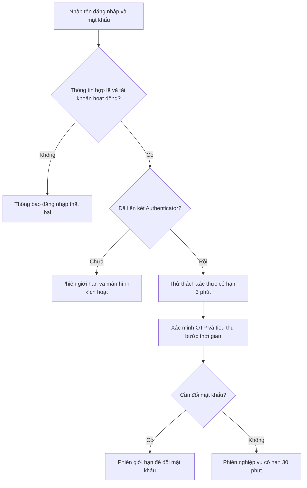
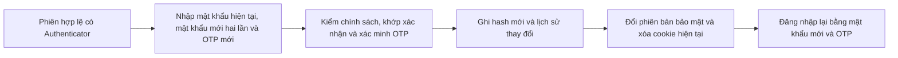

# Kiến trúc xác thực QLCD

Backend xác minh mật khẩu bằng PBKDF2-SHA256. Trình duyệt giữ cookie phiên HttpOnly cùng origin. SQL lưu bản băm token phiên, hạn dùng và phiên bản bảo mật. Mọi yêu cầu ghi dùng CSRF. Backend cấp vai trò nghiệp vụ khi tài khoản có Authenticator và đã hoàn tất đổi mật khẩu bắt buộc.

## Đăng nhập và tiếp tục thiết lập

Phiên giới hạn có hạn tối đa 10 phút và có thể kết thúc sớm hơn theo hạn mật khẩu tạm. Khi người dùng rời luồng, lần đăng nhập tiếp theo đọc lại trạng thái đã lưu từ SQL. Khóa QR tạo dở có thể tạo lại bằng mã kích hoạt còn hiệu lực. Một phiên chưa hoàn tất sẽ bị từ chối khi gọi trực tiếp API nghiệp vụ.

## Đổi mật khẩu

Mật khẩu mới có 8–128 ký tự, gồm ít nhất một chữ hoa, một chữ thường, một chữ số và một ký tự dấu câu hoặc ký hiệu. Khoảng trắng không đáp ứng điều kiện ký tự đặc biệt. Người dùng phải đổi mật khẩu khởi tạo `123456aA@` trước khi vào nghiệp vụ. Mật khẩu mới phải khác mật khẩu khởi tạo và mật khẩu hiện tại. Đổi mật khẩu giữ khóa Authenticator và bộ mã khôi phục hiện tại. [Thiết lập Authenticator](TWO_FACTOR_AUTHENTICATION.md) · [Kiểm thử](TESTING.md)
