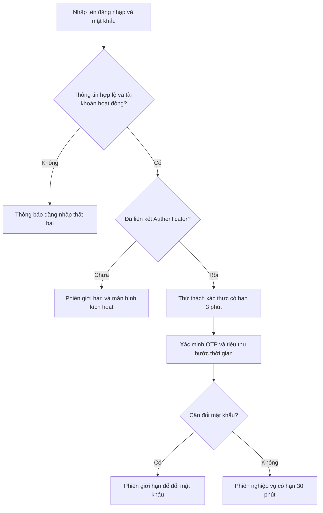
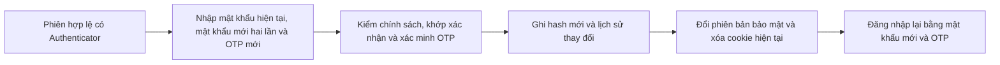

# Kiến trúc xác thực QLCD

Backend xác minh mật khẩu bằng PBKDF2-SHA256. Trình duyệt giữ cookie phiên HttpOnly cùng origin. SQL lưu bản băm token phiên, hạn dùng và phiên bản bảo mật. Mọi yêu cầu ghi dùng CSRF. Backend cấp vai trò nghiệp vụ khi tài khoản có Authenticator và đã hoàn tất đổi mật khẩu bắt buộc.

## Đăng nhập và tiếp tục thiết lập

Phiên giới hạn có hạn tối đa 10 phút và có thể kết thúc sớm hơn theo hạn mật khẩu tạm. Khi người dùng rời luồng, lần đăng nhập tiếp theo đọc lại trạng thái đã lưu từ SQL. Khóa QR tạo dở có thể tạo lại bằng mã kích hoạt còn hiệu lực. Một phiên chưa hoàn tất sẽ bị từ chối khi gọi trực tiếp API nghiệp vụ.

## Đổi mật khẩu

Mật khẩu mới có 8–128 ký tự, gồm ít nhất một chữ hoa, một chữ thường, một chữ số và một ký tự dấu câu hoặc ký hiệu. Khoảng trắng không đáp ứng điều kiện ký tự đặc biệt. Người dùng phải đổi mật khẩu khởi tạo `123456aA@` trước khi vào nghiệp vụ. Mật khẩu mới phải khác mật khẩu khởi tạo và mật khẩu hiện tại. Đổi mật khẩu giữ khóa Authenticator và bộ mã khôi phục hiện tại. [Thiết lập Authenticator](TWO_FACTOR_AUTHENTICATION.md) · [Kiểm thử](TESTING.md)

## Mật khẩu khởi tạo và các luồng quản trị

Nguồn chuẩn của mật khẩu khởi tạo là `QLCD.Shared/Security/PasswordHasher.cs`, hằng `InitialPassword = "123456aA@"`; `AccountCredentials.InitialPassword` tham chiếu hằng này. Đây là chính sách trong source, không lấy từ appsettings, không sinh ngẫu nhiên theo tài khoản. Mỗi lần ghi dùng PBKDF2 với salt riêng nên hash giữa các tài khoản khác nhau dù mật khẩu khởi tạo giống nhau. Thời hạn mật khẩu tạm và mã kích hoạt được định nghĩa riêng trong `AccountCredentials` (hiện đều 24 giờ).

| Luồng | Mật khẩu sau thao tác | Trạng thái và yêu cầu tiếp theo |
| --- | --- | --- |
| Tạo đơn vị, tự sinh tài khoản CDCS/CDBP/TOCD | `123456aA@` | Khóa, `MustChangePassword=true`, chưa bắt đầu hạn mật khẩu tạm. Admin xác minh danh tính và cấp mã để mở tài khoản mới và bắt đầu hạn 24 giờ. |
| Cấp mã kích hoạt cho tài khoản cũ chưa có MFA | Giữ nguyên | Không reset mật khẩu. Mã kích hoạt có hạn 24 giờ; không tự mở khóa tài khoản cũ. |
| Reset mật khẩu qua `/accounts/{id}/reset-password` | `123456aA@` cho mọi vai trò đích được hỗ trợ, kể cả ADMIN khác | Có hạn 24 giờ, bắt buộc đổi, thu hồi phiên qua SecurityVersion. Giữ Authenticator, mã khôi phục và trạng thái khóa. |
| Reset 2FA qua `/accounts/{id}/reset-2fa` | Giữ nguyên | Thay mã kích hoạt, xóa MFA/mã khôi phục cũ, thu hồi phiên; giữ cờ và hạn đổi mật khẩu cũng như trạng thái khóa. |
| CLI `--bootstrap-admin` / khôi phục khẩn cấp `--provision-account` | `123456aA@` | Mở tài khoản, yêu cầu đổi mật khẩu trong 24 giờ và đăng ký lại MFA bằng mã riêng. Provision chỉ dành cho quản trị viên chỉ định. |
| CLI `--issue-mfa-enrollment` / khôi phục bằng mã cá nhân | Giữ nguyên | Chỉ thay hoặc thiết lập MFA theo quy trình; không reset mật khẩu. |

Không có form tạo tài khoản độc lập trong giao diện hiện tại: tài khoản quản lý được tạo cùng đơn vị; quản trị viên đầu tiên được bootstrap bằng CLI. Chỉ `qlcd_admin` khớp ID cấu hình được reset tài khoản khác, không được tự reset qua API quản trị. Backend vẫn chặn nghiệp vụ ở phiên giới hạn và từ chối mật khẩu khởi tạo khi chọn mật khẩu mới. `GET /api/v1/accounts` trả thêm `credentialPolicy` để giao diện quản trị hiển thị đúng mật khẩu khởi tạo và thời hạn từ backend; không trả mật khẩu hay hash riêng của từng tài khoản.

## Trạng thái tổ chức và khóa tài khoản

Điều kiện truy cập gồm: tài khoản không bị soft-delete, cờ khóa đang mở, đơn vị liên kết và toàn bộ tổ tiên đang hoạt động. ADMIN không liên kết đơn vị tiếp tục dùng cơ chế quản trị hệ thống; nếu ADMIN có liên kết đơn vị thì cũng chịu điều kiện đơn vị. Điều kiện này được kiểm tra ở đăng nhập, mỗi yêu cầu xác thực phiên và dịch vụ phạm vi. Các truy vấn tiếp nhận đoàn viên cũng loại đơn vị có tổ tiên ngừng hoạt động.

Ngừng đơn vị không xóa hoặc khóa cờ riêng của tài khoản: UI hiển thị đồng thời “Đã mở khóa/Bị khóa” và “Bị chặn truy cập do đơn vị”. API accounts bổ sung `organizationActive`, `accountArchived`, `canSignIn`. Tài khoản gắn tổ chức bị soft-delete theo luồng cũ được đọc qua truy vấn quản trị có chủ đích để không biến mất; truy vấn đăng nhập/phiên vẫn giữ global filter. Kiểm tra cấu trúc trong validation có thể đếm cả con lưu trữ để không bỏ sót quan hệ; OperationalUnits luôn kiểm tra rõ IsDeleted và trạng thái của từng tổ tiên trước khi cấp quyền. Danh sách không tự phục hồi dữ liệu.

Ngừng đơn vị thu hồi phiên của mọi tài khoản gắn trực tiếp. Khôi phục còn thu hồi phiên thuộc nhánh con tối đa ba cấp để xử lý dữ liệu cũ có cha ngừng nhưng con vẫn hoạt động. Chỉ SecurityVersion thay đổi; cờ khóa, MFA và trạng thái con không đổi. Phiên cũ không sống lại khi khôi phục. Với tài khoản soft-delete cũ, quản trị viên phải mở khóa/khôi phục riêng (không áp dụng tự phục hồi ADMIN qua toggle). Các bản ghi thực sự đã bị hard-delete ở môi trường ngoài repo không thể tái tạo bằng luồng này.

## Mở khóa kèm khôi phục đơn vị theo yêu cầu mới

Quy tắc mới thay cho luồng toggle mở khóa không đổi cây: POST /accounts/{id}/unlock chỉ nhận phiên ADMIN đầy đủ, xác nhận rõ, mật khẩu admin và OTP mới; kiểm tra lại vai trò/trạng thái/proof phiên tại DB, không cho tự mở hoặc mở ADMIN. Khác với reset thông tin xác thực, thao tác này dành cho các ADMIN hợp lệ, không đòi quyền CredentialResetPermission; các API reset vẫn giữ hạn chế qlcd_admin.

Trong transaction Serializable: kiểm chứng actor, xác định đúng OrganizationId, khôi phục chính đơn vị nếu ngừng/IsDeleted (cha phải hoạt động), mở tài khoản đã chọn, clear tombstone cũ của tài khoản và thu hồi phiên/audit AUTH_ACCOUNT_UNLOCK cùng ORG_RESTORE khi có. OrganizationLifecycle tham gia transaction đang có, không commit riêng; lỗi cuối phải rollback cả phần restore đã save, trạng thái tài khoản, bước OTP và audit. Các tài khoản khác không được đổi cờ khóa/MFA/password; các phiên liên quan không được hồi sinh. Khối chỉ phân loại và không cản khôi phục khi liên kết khối cũ đã ngừng dùng.

Toggle v1 giữ tương thích cho thao tác khóa nhưng trả 409 khi bị dùng để mở; client cần chuyển sang endpoint unlock. Cấp mã kích hoạt bị từ chối khi đơn vị ngừng/ẩn để không vượt bước khôi phục có xác thực. Mở khóa không thay mật khẩu/Authenticator/hạn tạm và không thay thế các bước kích hoạt của tài khoản mới. API lỗi xác thực admin trả thông báo an toàn riêng, không ghi mật khẩu/OTP vào audit/log.
