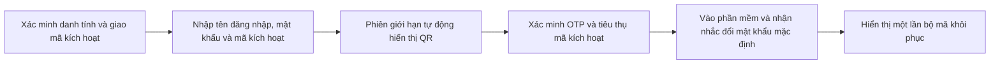

# Xác thực hai bước bằng Authenticator

Mọi vai trò, gồm quản trị viên và mọi môi trường chạy, phải dùng Authenticator. Tài khoản mới khởi tạo với `123456aA@`, được băm bằng salt riêng. Quản trị viên đối chiếu danh tính và cấp mã kích hoạt ngẫu nhiên qua kênh riêng. Tài khoản cũ chưa có Authenticator được cấp mã thiết lập và dùng mật khẩu hiện tại.

1. Trên trang đăng nhập, chọn **Thiết lập Authenticator bằng mã kích hoạt** nếu đây là lần thiết lập đầu tiên hoặc quản trị viên vừa Reset 2FA. Nhập tên đăng nhập, mật khẩu và mã kích hoạt được cấp trong vòng 24 giờ.
2. Dùng Google Authenticator, Microsoft Authenticator hoặc ứng dụng TOTP tương thích để quét QR. Có thể chọn **Nhập khóa thiết lập thủ công**. Tải lại trang trong thời hạn phiên sẽ hiển thị lại cùng QR.
3. Nhập 6 chữ số và chọn **Xác nhận và bật**. Hệ thống hiển thị bộ mã khôi phục một lần và đưa tài khoản mới vào phần mềm. Lưu riêng bộ mã rồi chọn **Tôi đã lưu mã**. Với mật khẩu khởi tạo lần đầu, bạn có thể đổi sau. Nếu quản trị viên đã Reset mật khẩu, bạn phải đổi mật khẩu tạm trước khi vào nghiệp vụ. Các lần đăng nhập tiếp theo dùng mật khẩu và OTP.

Khi Authenticator đã liên kết, nhập tên đăng nhập và mật khẩu ở form mặc định, rồi nhập OTP sáu chữ số khi chuyển sang bước **Xác thực hai bước**.

QLCD dùng Otp.NET cho TOTP theo RFC 6238, 6 chữ số, chu kỳ 30 giây với dung sai ±1 bước, và QRCoder tạo ảnh tại backend. Mỗi bước đã xác thực chỉ được chấp nhận một lần. Khóa sinh từ bộ tạo số ngẫu nhiên mật mã, mã hóa bằng Data Protection và gắn với ID tài khoản. [RFC 6238](https://www.rfc-editor.org/rfc/rfc6238)
