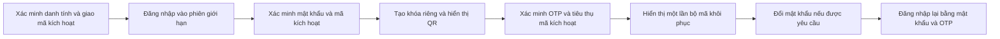

# Xác thực hai bước bằng Authenticator

Mọi vai trò, gồm quản trị viên và mọi môi trường chạy, phải dùng Authenticator. Tài khoản mới khởi tạo với `123456aA@`, được băm bằng salt riêng. Quản trị viên đối chiếu danh tính và cấp mã kích hoạt ngẫu nhiên qua kênh riêng. Tài khoản cũ chưa có Authenticator được cấp mã thiết lập và dùng mật khẩu hiện tại.

1. Mở **Bảo mật tài khoản** theo hướng dẫn sau khi đăng nhập. Nhập mật khẩu và mã được cấp trong vòng 24 giờ.
2. Chọn **Tạo mã QR**. Dùng Google Authenticator, Microsoft Authenticator hoặc ứng dụng TOTP tương thích để quét. Có thể chọn **Nhập khóa thiết lập thủ công**.
3. Nhập hoặc dán 6 chữ số, chọn **Xác nhận và bật**, lưu bộ mã khôi phục rồi chọn **Tôi đã lưu mã**. Dùng mã mới cho thao tác kế tiếp.

QLCD dùng Otp.NET cho TOTP theo RFC 6238, 6 chữ số, chu kỳ 30 giây với dung sai ±1 bước, và QRCoder tạo ảnh tại backend. Mỗi bước đã xác thực chỉ được chấp nhận một lần. Khóa sinh từ bộ tạo số ngẫu nhiên mật mã, mã hóa bằng Data Protection và gắn với ID tài khoản. [RFC 6238](https://www.rfc-editor.org/rfc/rfc6238)
