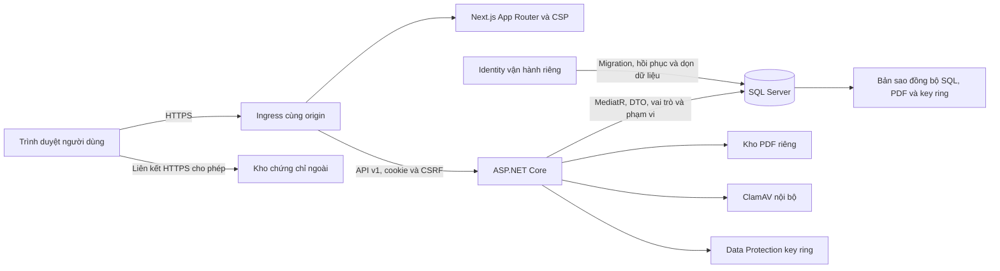

# Kiểm duyệt an toàn thông tin QLCD

**Ngày 26/11/2026.** Phạm vi là nhánh `qlcd-app` tại `173a47e` cùng thay đổi chưa commit, gồm luồng đăng nhập mới và migration chưa áp lên `QLCD_Local`. Rà soát qua mã, lịch sử Git đã che giá trị, quy tắc phân tích tĩnh, lockfile và kiểm thử phòng thủ trên loopback bằng tài khoản, hồ sơ và PDF tổng hợp. Việc đánh giá hạ tầng, cấu hình ingress, quyền SQL, sao lưu và bản phát hành đích cần bằng chứng vận hành.

## Kiến trúc và biên tin cậy

Tài sản gồm hồ sơ định danh và thông tin nhạy cảm, lịch sử chuyển sinh hoạt, phúc lợi, tài chính, minh chứng, khóa TOTP, quyền quản trị và nhật ký. Biên chính nằm ở trình duyệt–ingress, ingress–API, API–SQL/volume/key ring và kết nối scanner. Cấu hình môi trường, Git/CI và kho chứng chỉ là biên riêng. Phân loại và quy trình xử lý dữ liệu được ghi trong [Bảo vệ dữ liệu](DATA_PROTECTION.md).

| STRIDE | Kiểm tra và kết quả |
| --- | --- |
| Giả mạo | PBKDF2 có salt, mã kích hoạt, TOTP và kiểm chống dùng lại. Cookie phiên HttpOnly, SameSite, Secure ngoài local. Phiên giới hạn không mang vai trò nghiệp vụ. Tách reset theo ID ADMIN được chỉ định, xác thực lại và theo dõi khóa/thu hồi phiên. |
| Sửa đổi | DTO tách entity, validation, kiểm CSRF và scope trên giao dịch/đối tượng. Đối chiếu quyền xóa, ngừng và khôi phục. Bổ sung điều kiện đồng thời vào SQL do scope/trạng thái có thể đổi giữa kiểm tra và ghi. |
| Chối bỏ | Audit theo actor, đối tượng, UTC và trace, API log theo trạng thái. Bổ sung audit OTP hoàn tất, đọc hồ sơ và tải minh chứng. Đích lưu chống sửa cần nghiệm thu. |
| Lộ dữ liệu | DTO giới hạn theo scope, no-store, CSP nonce và chống framing. PDF tải qua API và chỉ cho phép origin chứng chỉ được cấu hình. Tồn tại vật liệu cấu hình trong lịch sử Git. Mã hóa đĩa và ACL bản sao cần bằng chứng. |
| Từ chối dịch vụ | Có ngưỡng request và phân trang, quota PDF, thời hạn scanner, rate limit IP và khóa đăng nhập SQL. Cần đo truy vấn tổng hợp và ngân sách lưu bộ đếm trên dữ liệu đại diện. |
| Leo thang quyền | Kiểm quyền staff và role ở API, phạm vi qua `OrganizationScopeService`, quyền duyệt ở handler. Đối chiếu ID trong route/body, tài khoản/đơn vị hoạt động, và quyền trên cả quan hệ đọc/ghi. Cần nghiệm thu ma trận quyền nghiệp vụ đầy đủ với chủ hệ thống. |

## Phạm vi kiểm soát

- **API và dữ liệu.** Kiểm kê thuộc tính authorize, allow-anonymous, các giới hạn upload/auth, CRUD của đoàn viên/đơn vị/tài khoản, hoạt động, tài chính, phúc lợi, sáng kiến, thi đua, danh mục và báo cáo tổng hợp. Rà DTO, điều kiện tìm kiếm/scope trước phân trang, dữ liệu người đã chuyển và xử lý lỗi. Dùng EF và SQL tham số cho lock. Rà điểm thực thi lệnh, ghép SQL, render HTML, liên kết ngoài và đường dẫn. Các kiểm tra thuật toán thực hiện trong phạm vi luật SAST công bố và chỗ sử dụng đã đọc.
- **Xác thực.** Xem chính sách mật khẩu, OTP, Data Protection, kích hoạt, khôi phục, session version, cookie và khóa bền SQL. Hợp đồng lần đầu và reset hiện có được giữ. QLCD dùng cookie với token ngẫu nhiên tra qua hash trong SQL. Access JWT và refresh token không thuộc thiết kế hiện tại.
- **Tệp và frontend.** Kiểm tra ràng buộc module, GUID lưu riêng, đường dẫn cũ, giới hạn kiểu/kích thước, quét PDF và download. Kiểm tra CSP/headers, CSRF, cache, hồi quy và dữ liệu trong console/storage. Repo chưa có endpoint xuất Excel/CSV, nạp tệp nén hoặc đầu ra PDF tổng hợp trong controller đã kiểm kê. Quy tắc khi bổ sung nằm trong [Bảo vệ dữ liệu](DATA_PROTECTION.md).
- **Cơ sở dữ liệu và vận hành.** Kiểm model/unique/FK, filter xóa mềm, transaction, SQL TLS, cấu hình proxy, kiểm soát Swagger và readiness, tách principal runtime/DDL và gate CI. Chưa quan sát ingress/cấu hình đích, quyền tài khoản máy dịch vụ, ClamAV thật, đích audit chống sửa, hồ sơ pháp lý và restore cùng tệp/key ring. Repo chưa cung cấp topology/container production để đánh giá hiệu lực các cấu hình đó.

## Phát hiện và trạng thái

Tổng hợp đợt này gồm **0 Critical, 2 High, 5 Medium, 2 Low**. Mức độ dựa trên tác động và điều kiện xảy ra. Các hàng có nhãn vận hành là điều kiện cần bằng chứng hoặc quyết định. Kết quả hiện tại chưa đủ để phê duyệt phát hành.

| ID và mức | Bằng chứng, điều kiện và ảnh hưởng | Khắc phục và kiểm lại |
| --- | --- | --- |
| QSEC-01 · High · đã sửa trong code | Các lệnh ghi đối tượng nghiệp vụ kiểm trạng thái và scope trước `SaveChangesAsync`. Model cũ thiếu điều kiện đồng thời trên đơn vị, loại tài chính, trạng thái duyệt và xóa mềm. Khi một yêu cầu ghi khác làm đổi các thuộc tính đó, quyền đã kiểm có thể hết hiệu lực trước khi ghi, dẫn đến sai dữ liệu hoặc sửa bản ghi đã duyệt. | Dùng concurrency token cho thuộc tính dùng để phân quyền và xóa mềm. API dùng xử lý xung đột hiện có. Migration `GuardScopedWrites` chỉ đồng bộ EF snapshot và lịch sử, không sửa cột hay bản ghi nghiệp vụ. Kiểm thử SQL hai context xác nhận ghi cũ bị từ chối sau duyệt, đổi đơn vị và lưu trữ. |
| QSEC-02 · High · mở | Lịch sử Git chứa trường mật khẩu SQL có giá trị trong `backend/QLCD.Api/appsettings*.json` và cấu hình cũ của AttendanceManagement. Luật riêng Gitleaks ghi 14 lần khớp lịch sử trên mọi ref, gồm 8 lần thuộc QLCD. Kiểm theo cấu trúc xác nhận dấu vết tại `262eb9e`, `71d1b4e` và `5ff3727`. Khả năng sử dụng phụ thuộc hiệu lực credential, kết nối SQL và quyền của principal. | Bộ cấu hình hiện hành đọc giá trị ngoài Git. Đã thêm luật theo cấu hình SQL vào gate. Vận hành cần xác minh đã vô hiệu hoặc xoay ở từng môi trường, kiểm credential trùng, backup, log và bản phát hành cũ. Cần bằng chứng thu hồi hoặc chấp nhận rủi ro trước phát hành. |
| QSEC-03 · Medium · đã sửa trong code | Audit SQL trước đây ghi thay đổi và thất bại đăng nhập nhưng không ghi đủ lần hoàn tất OTP, đọc DTO chi tiết chứa thông tin định danh và tải PDF thành công. Điều tra hành vi từ phiên hợp lệ thiếu dấu vết đối tượng. | Ghi `AUTH_LOGIN_SUCCESS`, `MEMBER_DETAIL_READ` và `EVIDENCE_DOWNLOAD` với ID/trace. Kiểm HTTP/SQL xác nhận sự kiện và không có nội dung credential, hồ sơ hay tệp trong chi tiết audit. |
| QSEC-04 · Medium · cần quyết định nghiệp vụ | Mật khẩu khởi tạo dùng chung và cờ nhắc có thể tồn tại sau lần đầu. PBKDF2 ngăn đọc trực tiếp hash và OTP/mã kích hoạt vẫn cần thiết. Mật khẩu dùng chung giảm giá trị của một lớp xác thực, nhất là nếu mã kích hoạt bị lộ hoặc người dùng gặp lừa đảo OTP. | Giữ nghiệp vụ đã duyệt. Đề xuất mã cấp riêng qua kênh xác minh, rút thời hạn bàn giao từ 24 giờ xuống theo quy trình trực sau phê duyệt, và đo tài khoản chưa đổi qua cờ nhắc. Đề xuất thời hạn chuyển đổi 7 ngày sau kích hoạt, sau đó chuyển sang mật khẩu tạm ngẫu nhiên theo tài khoản. Thí điểm với tài khoản tổng hợp, thu hồi phiên khi đổi và có phương án cấp lại có kiểm soát. Ưu tiên đánh giá MFA chống phishing cho quản trị viên. |
| QSEC-05 · Medium · vận hành | Repo có SQL TLS, CSP, HSTS, proxy tin cậy, scanner và key ring. Chưa có evidence đích cho ACL, runtime SQL least privilege, volume và backup mã hóa, cổng tiếp xúc và CORS/ingress. Nếu quyền hoặc đường mạng cấu hình rộng, ảnh hưởng trải từ lộ dữ liệu đến chiếm quyền vận hành. | Đội vận hành nghiệm thu danh mục theo phiên bản thực tế và thực hành backup/restore đồng bộ. Kiểm `Storage__Root`, scanner fail-closed, private network, chứng thư, key ring, proxy và quyền DB đọc/ghi. Đo RPO/RTO và ký duyệt cutover. |
| QSEC-06 · Medium · vận hành | `AuditLogInterceptor` và audit đọc ghi SQL. Repo chưa chứng minh chuyển log sang đích độc lập chống sửa, retention hoặc cảnh báo. Tài khoản có quyền cao trên SQL có thể làm giảm độ tin cậy điều tra. | Áp ACL ghi/đọc tối thiểu và chuyển bản sao chống sửa. Xác định người trực và kiểm cảnh báo, retention, điều tra mẫu. [Ứng phó sự cố](INCIDENT_RESPONSE.md) |
| QSEC-07 · Medium · cần quyết định dữ liệu | Hồ sơ chi tiết có CCCD, liên lạc, dân tộc, tôn giáo, chính trị và tệp. `IsDeleted` giữ bản ghi. Chưa có bằng chứng phê duyệt mục đích cho từng nhóm trường, retention, hủy liên kho, xử lý yêu cầu chủ thể và người nhận. | Chủ dữ liệu và pháp chế phê duyệt danh mục và lịch vòng đời. Chỉ mở rộng thu thập, chia sẻ hoặc xóa thật theo phê duyệt. [Bảo vệ dữ liệu](DATA_PROTECTION.md) |
| QSEC-08 · Low · theo dõi | Bộ đếm tên chưa nhận diện giữ các lần sai chưa tới ngưỡng và truy vấn tổng quan còn tổng hợp một phần trong tiến trình. Có giới hạn IP và lệnh dọn các khóa ẩn danh đã hết hạn, nhưng dung lượng, truy vấn và chống lạm dụng qua nhiều replica chưa đo tải. | Đo độ tăng bảng và truy vấn với quy mô đại diện. Chốt retention, hạn mức ingress và cảnh báo dung lượng trước phát hành. |
| QSEC-09 · Low · CI repo đã chỉnh, nghiệm thu vận hành | Workflow có PR và push `main`, thiếu push trực tiếp vào nhánh `qlcd-app`. NuGet restore chưa nâng advisory High/Critical và lỗi truy vấn audit thành lỗi gate. | Bật push `qlcd-app`, gate NU1903/NU1904/NU1900. Xác minh YAML tại chỗ. Chưa chạy GitHub Actions hoặc cấu hình required check trên remote. |

## Chuẩn đối chiếu

Phiên bản đối chiếu vào ngày rà soát. OWASP Top 10 và CWE là danh mục rủi ro, ASVS Level 2 là mục tiêu kiểm chứng, SSDF là khung vòng đời. Không suy diễn chứng nhận hoặc đủ toàn bộ yêu cầu từ kết quả quét.

- OWASP Top 10:2025, API Security Top 10:2023, ASVS 5.0.0 và Cheat Sheet Series để đối chiếu quyền, phiên, validation, dữ liệu và kiểm thử. [OWASP Top 10](https://top10.owasp.org/2025/) · [API Security](https://api-security.owasp.org/editions/2023/en/0x11-t10/) · [ASVS](https://asvs.owasp.org/) · [Cheat Sheet Series](https://cheatsheetseries.owasp.org/)
- CWE Top 25 bản 2025 và NIST SSDF SP 800-218 1.1 bản chính thức. Bản 1.2 được liệt kê là dự thảo. NIST SP 800-63-4 và 800-63B-4 bản tháng 7/2025 dùng cho phân tích danh tính và xác thực. [CWE](https://cwe.mitre.org/top25/) · [SSDF](https://csrc.nist.gov/Projects/ssdf/publications) · [NIST Digital Identity](https://csrc.nist.gov/pubs/sp/800/63/4/final) · [Authenticator Management](https://csrc.nist.gov/pubs/sp/800/63/B/4/final)
- CIS chỉ áp theo phiên bản SQL Server/Windows Server và vai trò máy thực tế. Catalog liệt kê SQL Server 2025 1.0.1 và Windows Server 2025 2.1.1. ISO/IEC 27001:2022 cùng Amd 1:2024 và ISO/IEC 27002:2022 là tham chiếu ISMS và danh mục kiểm soát. [CIS Benchmarks](https://www.cisecurity.org/cis-benchmarks) · [ISO/IEC 27001](https://www.iso.org/standard/27001) · [Amd 1:2024](https://www.iso.org/standard/88435.html) · [ISO/IEC 27002](https://www.iso.org/standard/75652.html)
- Việt Nam. Luật Bảo vệ dữ liệu cá nhân 91/2025/QH15 và Nghị định 356/2025/NĐ-CP có hiệu lực 01/01/2026. Luật An ninh mạng 116/2025/QH15 có hiệu lực 01/07/2026. Đầu mối pháp chế xác nhận phạm vi áp dụng, quy định dưới luật và nghĩa vụ theo dữ liệu/hạ tầng của bệnh viện. [Luật 91](https://vanban.chinhphu.vn/?docid=214590&pageid=27160) · [Nghị định 356](https://vanban.chinhphu.vn/?docid=216387&pageid=27160) · [Luật 116](https://vanban.chinhphu.vn/?docid=216499&pageid=27160)

## Kết quả kiểm chứng và vận hành

| Hạng mục | Bằng chứng tại máy làm việc |
| --- | --- |
| Build và phụ thuộc | Locked restore với audit toàn dependency và gate NU1900/NU1903/NU1904, build Debug/Release thành công. `npm run lint -- --max-warnings 0`, production build và typecheck thành công. `npm audit --json` và `dotnet list backend/QLCD.sln package --vulnerable --include-transitive --no-restore` báo 0 advisory áp dụng tại nguồn truy vấn. |
| SAST và bí mật | Semgrep 1.185.0 chạy 4 luật repo trên 168 tệp được áp luật, 0 phát hiện. Gitleaks 8.30.1 với luật mặc định và luật repo cho thấy 0 khớp trong working tree đã loại trừ tệp ignored, 14 khớp trong lịch sử mọi ref. Quét chỉ bao phủ các luật đã chạy. |
| SBOM và giấy phép | `npm sbom --package-lock-only --sbom-format cyclonedx` xuất CycloneDX 1.5 cho 460 thành phần frontend có metadata giấy phép. Cả 454 URL `resolved` trong npm lockfile dùng registry npm chính thức. Đối chiếu 89 cặp tên/phiên bản NuGet từ lockfile với nuspec, gồm 78 biểu thức, 8 tệp và 3 URL. Kiểm tra metadata chưa thay thế việc duyệt nghĩa vụ giấy phép. Workflow xuất SBOM cả hai hệ sinh thái. |
| Đơn vị và API | xUnit mặc định 87 qua và 3 ca cần SQL bị bỏ qua trong lượt mặc định. Chạy riêng nhóm khóa đăng nhập và mở khóa trên SQL Express qua 14 ca. `node tools/test-security-smoke.mjs` và bản `--sql-local` đều qua. Bộ SQL xác nhận audit truy cập hợp lệ và thu hồi phiên từ tài khoản tổng hợp trên loopback. |
| Migration và phục hồi | `dotnet ef migrations has-pending-model-changes` xác nhận model khớp. `tools/test-sql.ps1 -RehearseRestore` qua 7 ca, áp 8 migration từ schema trống và schema cũ, áp lại idempotent, xác minh backup checksum, restore riêng và DBCC CHECKDB. Ca ghi đồng thời xác nhận chặn chỉnh sau duyệt, đổi scope và xóa mềm. |
| Giao diện | Browser smoke qua 32 nhóm luồng, 98 ảnh, 0 tràn ngang hoặc lỗi API/JavaScript ngoài dự kiến, 0 vi phạm axe trên 14 trang kiểm tra. Kiểm kê nút reset, MFA, khóa/mở, truy cập và thao tác nghiệp vụ. |
| Phạm vi chưa nghiệm thu | Chưa chạy workflow qua GitHub hoặc scanner DAST chuyên dụng. Kiểm thử động dùng HTTP/browser hồi quy trên loopback. Chưa nghiệm thu production, scanner thật, phân quyền hạ tầng, tải, hoặc tuân thủ tổ chức. Validate 4 SKILL.md và cú pháp YAML tại chỗ. |

`QLCD_Local` vẫn có 6 migration tại lúc kiểm tra. Khi được phê duyệt, áp `LoginLockoutAndEnrollment` rồi `GuardScopedWrites` bằng principal DDL trước khi chạy API mới. Diễn tập và sao lưu đồng bộ trên môi trường đích. Cần bằng chứng thu hồi credential lịch sử, required checks chạy thực tế và quyết định của chủ dữ liệu trước khi phê duyệt phát hành. [Runbook](../SECURITY.md) · [Cổng kiểm tra](07-security-checklist.md)
